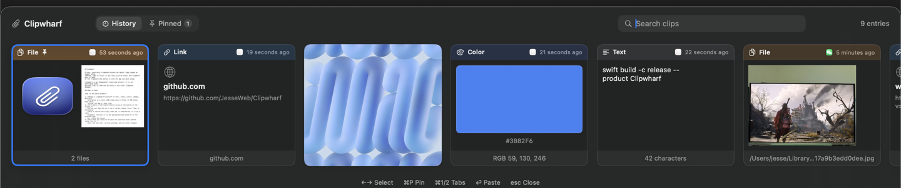

# Clipwharf

极简、纯本地的 macOS 剪贴板历史工具。



[English](README.md) · **[简体中文](README.zh-CN.md)** · [繁體中文](README.zh-TW.md) · [日本語](README.ja.md) · [Français](README.fr.md) · [Español](README.es.md)

Clipwharf 是一个纯本地的 macOS 剪贴板历史工具。照常复制，按 **⌘⇧V**，选一张卡片，它会把内容放回剪贴板并粘贴到你刚才使用的 App 里。

独立实现（clean-room），与 Paste 等商业剪贴板管理软件没有关联，也不包含它们的任何代码、素材或图标。无账号、无云端、无统计，数据不会离开你的 Mac。

## 功能

- **五种卡片**：文本、链接、颜色、图片、文件。文件用系统 QuickLook 预览（和访达一致），一次复制多个文件会显示 2×2 缩略图网格和 “+N” 角标。
- **固定板**：`⌘P` 固定卡片，固定项有独立页签，且不会被 200 条历史上限淘汰。
- **搜索**：忽略大小写，多个词需同时匹配；可搜正文、文件名、链接域名，以及**来源 App 名称**。
- **来源 App 标识**：每张卡片显示复制时所在 App 的图标。
- **跳过密码管理器**：1Password、Bitwarden、LastPass、Dashlane、钥匙串访问、Passwords、Keeper 复制的内容不会入库。
- **登录时启动**：菜单栏图标 → *Launch at Login*。
- **纯本地**：`~/Library/Application Support/Clipwharf` 下的 JSON 索引 + PNG 图片目录。

## 系统要求

- macOS 13 Ventura 或更新
- Xcode 15 或更新（Swift 5.9+）

## 安装

**方式一：让 AI 帮你装（最省事）**

把下面这段发给 Claude Code / Codex / Cursor 等能执行命令的 AI 编程工具：

> 把 https://github.com/JesseWeb/Clipwharf 克隆到本地，阅读 AGENTS.md，
> 用 `./scripts/make-app.sh release` 构建 Clipwharf.app 并安装到 /Applications，
> 启动后告诉我需要在辅助功能里打开哪一项、以及怎么验证自动粘贴生效。

AI 会按 [`AGENTS.md`](AGENTS.md) 里的步骤构建、安装并引导授权；更多提示词变体见 [`docs/ai-install.md`](docs/ai-install.md)。

**方式二：自己构建**

```sh
git clone https://github.com/JesseWeb/Clipwharf.git
cd Clipwharf
./scripts/make-app.sh release
open dist/Clipwharf.app
```

构建完把 `dist/Clipwharf.app` 拖进 `/Applications`，以后就从那里启动（权限也记在这个路径上）。

**方式三：无需下载。**

Clipwharf 不发布任何二进制，GitHub Actions 只做编译与测试校验。请用方式二在本地构建，这样 app 带的是你自己的代码身份。

## 首次使用

1. 菜单栏出现回形针图标（无 Dock 图标、无主窗口；退出请右键图标 → Quit）。
2. 复制一段文字 / 一张图片 / 一个文件，按 **⌘⇧V**。
3. 打开辅助功能授权，让它能替你按 ⌘V：**系统设置 → 隐私与安全性 → 辅助功能 → 打开 Clipwharf**。未授权时会先把内容放进剪贴板，并提示你手动按 ⌘V。

## 快捷键

| 按键 | 作用 |
|---|---|
| ⌘⇧V | 打开/关闭历史面板（全局） |
| ← / → | 移动选中卡片 |
| ⏎ | 粘贴选中项 |
| ⌘P | 固定/取消固定 |
| ⌘1 / ⌘2 | 历史 / 固定页签 |
| esc | 关闭面板 |
| 单击 | 粘贴该卡片 |
| 右键 | 固定/取消固定、复制 |

## 数据位置

```
~/Library/Application Support/Clipwharf/
├── history.json   # 最新在前的索引
└── Blobs/         # 图片数据（<uuid>.png）
```

全部是明文 JSON 和普通文件。退出 Clipwharf 后删除该目录即可清空，不会写入其他位置。

## 关于签名与分发（重要）

- **仓库只放源码，不含任何二进制或签名材料**：`dist/` 已被 `.gitignore` 忽略，不会提交 `.app`、`.icns` 或证书。
- `scripts/make-app.sh` 使用的是**构建者本机**的签名身份：有 Apple Development 证书就用它，没有就退回 ad-hoc 签名。代码里没有硬编码任何开发者名称或 Team ID。
- 因此你在自己 Mac 上构建出来的 app 带的是**你自己的**代码身份，跟维护者的证书毫无关系，也不会因为维护者证书到期而受影响。
- **ad-hoc 签名与辅助功能**：macOS 把授权绑定在代码身份上。ad-hoc 身份每次重新构建都会变，于是列表里的开关看着是开的、新二进制却没权限。此时点菜单栏图标 → **Fix Accessibility Permission…** 重置后重新授权即可；用固定证书签名的构建不受影响。
- **把签好的 `.app` 发给别人是另一回事**：那需要 Developer ID + 公证，而且私钥绝不能公开。所以本项目只分发源码，让每个人在本地自行签名。

## 常见问题

| 现象 | 处理 |
|---|---|
| 辅助功能开关已打开，仍提示需要权限 | 菜单栏图标 → **Fix Accessibility Permission…**，再重新打开开关 |
| ⌘⇧V 没反应 | 可能被其他剪贴板工具（如 Paste）占用，退出它或用菜单栏图标 |
| 首次预览文件时提示“想访问其他 App 的数据” | macOS 隐私提示，允许一次即可 |
| 一点其他 App 面板就消失 | 这是设计：面板失焦会自动收起，再按 ⌘⇧V 即可 |
| 更新后历史为空 | 索引按用户存储，检查 `~/Library/Application Support/Clipwharf/history.json` |

## 开发

```sh
swift test                                  # 核心模型/存储/搜索/分类
swift build -c release --product Clipwharf
./scripts/make-app.sh debug
swift scripts/make-icon.swift               # 重新生成 Support/AppIcon.png
```

## 许可

Clipwharf 采用**非商业源码许可（source-available, noncommercial）**。你可以基于**非商业目的**
使用、修改和分发它；但**不得**将其用于商业用途、贩售或收费。商业使用需另行取得书面授权。

具有法律效力的条款见 [LICENSE](LICENSE)。未经授权的商业使用构成违约，权利人可主张损害赔偿、
返还所得利润、诉讼费用及律师费。
